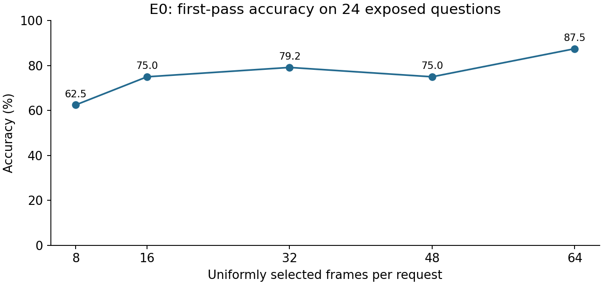
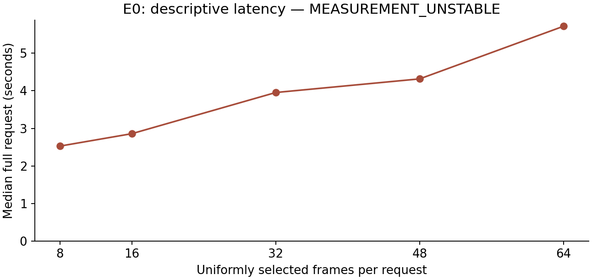
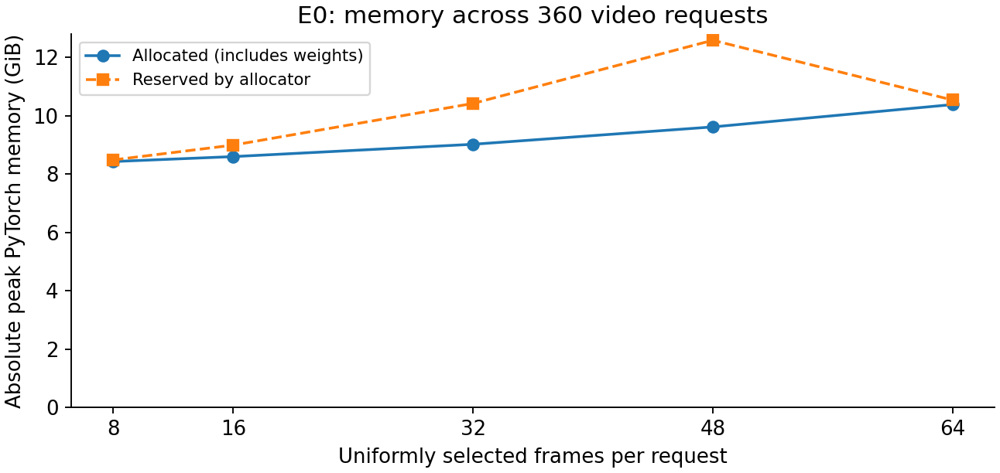
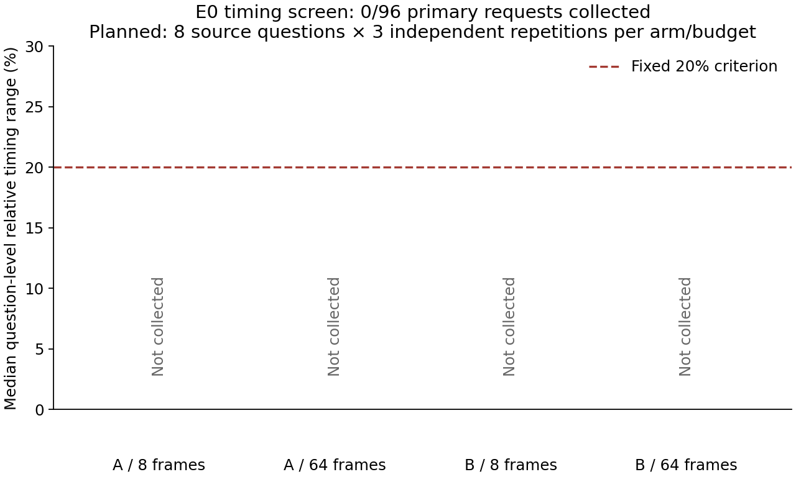
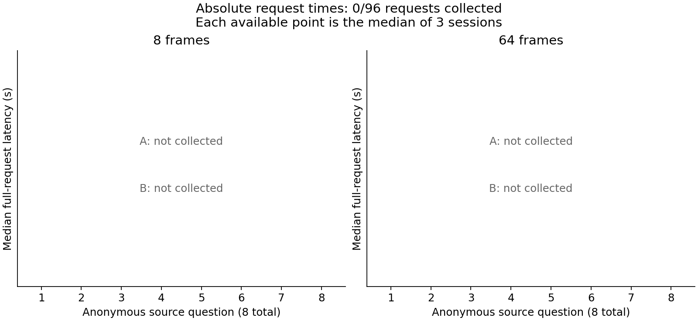

# video-compute-value

Processing more video can improve an answer, but it also adds computational cost.
We study whether inexpensive observations can help decide when additional visual
evidence is worth acquiring. Before building a decision policy, we first check
whether our measurements are reliable and whether choosing a different clip can
meaningfully change an answer.

We use a frozen video-language model and multiple-choice video questions. Our
current evidence comes from a small, exposed development cohort. We have not
trained a controller or demonstrated an adaptive policy or validated speedup.
This repository is separate from `video-refresh-benchmark`.

| Experiment | Question and endpoint | Data and controls | Current result |
|---|---|---|---|
| E0: feasibility and measurement | Can we fit, reproduce, score and time requests? Operational gates, descriptive accuracy and memory. | 8 short videos / 24 questions; uniform 8/16/32/48/64 frames; separate text-only diagnostic; 3 video repetitions. | Complete and independently verified; **MEASUREMENT_UNSTABLE**. |
| E1: additional-clip headroom | Can hindsight choice among four added clips improve accuracy? Primary: oracle − exact expected random. | Same exposed 8 videos / 24 questions; base 8 frames, four quarter additions and uniform addition at 16 frames; 2 passes. | H_choice = 18.75 pp; oracle − best fixed = 12.50 pp. |

Both experiments use **Video-MME v1**, short category, the official annotation
**test split**, revision `ead1408f75b618502df9a1d8e0950166bf0a2a0b`.
We use all three questions per source, unchanged. Because these videos and
questions have been exposed during development, neither experiment is an
untouched confirmation study. The eight videos are the independent clusters;
questions, candidate clips and repetitions are not independent additional videos.

The shared model, processor and tokenizer are **Qwen/Qwen3-VL-4B-Instruct**,
revision `ebb281ec70b05090aa6165b016eac8ec08e71b17`, BF16 and SDPA, with frozen
weights. Inputs are visual-only at the unchanged 192 × 320 canvas: no audio,
external subtitles, transcripts or generated captions. We keep the original
question and option order, prompt, strict answer parser and explicit greedy
generation controls fixed. One CUDA worker runs at a time, with no quantization
or offloading.

## Experiment 0: establish the measurement foundation

A frame-count comparison is useful only if it measures reproducible inputs and
real model requests. We varied the uniformly sampled frame budget while keeping
the cohort, model, spatial preprocessing and question fixed. Uniform-64 is a
sampled reference, not every frame or an accuracy upper bound. Uniform sets are
not necessarily nested.

The corrected greedy collection completed **360 video requests and 24 separate
text-only requests**, with 32 collection warmups and 25 preflight calls counted
separately. The first repetition determines accuracy; three repetitions measure
video-request repeatability. All inputs and generated tokens repeated exactly.
Only the 48-frame setting met the proposed 20% median timing-range criterion.
The operational verdict therefore remains **MEASUREMENT_UNSTABLE**.

| Uniform frames | Correct / 24 | Accuracy | Descriptive median request (s) | Median repetition range |
|---:|---:|---:|---:|---:|
| 8 | 15/24 | 62.50% | 2.528 | 65.11% |
| 16 | 18/24 | 75.00% | 2.859 | 29.33% |
| 32 | 19/24 | 79.17% | 3.954 | 24.27% |
| 48 | 18/24 | 75.00% | 4.317 | 18.48% |
| 64 | 21/24 | 87.50% | 5.718 | 26.66% |

The text-only diagnostic answered 14/24 correctly (58.33%). It is a separate
language-prior diagnostic, not a zero-cost adaptive choice. The historical
sampled collection is preserved but excluded from these corrected-greedy results:
checkpoint defaults had backfilled sampling despite a requested `do_sample=False`.
The corrected adapter records and verifies the effective greedy policy.

Regenerate all six research figures and the E1 report from saved data with:

```powershell
.venv\Scripts\python.exe scripts/report_e001.py --run-dir results/e001_20261029_132707_v1
```



E0 accuracy uses the first pass over 24 questions from eight videos. More frames
did not improve every answer monotonically. Source:
[results/e001_20261029_132707_v1/e0_plot_data.csv](results/e001_20261029_132707_v1/e0_plot_data.csv), exported from the
[corrected E0 aggregates](results/e000_20261028_greedy_collection_v3/public_summary.json).



E0 latency first takes the median of three repetitions per question, then the
median over 24 questions. The timer includes complete video decoding and full
inference. **Timing stability failed; these values do not validate efficiency.**
Source: [e0_plot_data.csv](results/e001_20261029_132707_v1/e0_plot_data.csv).



Absolute PyTorch peaks over 360 video requests include resident weights.
Reserved allocator memory differs from live allocated memory and total device
usage. Uniform-64 alone uses the frozen in-timer cache-trim policy.
Source: [e0_plot_data.csv](results/e001_20261029_132707_v1/e0_plot_data.csv).

A separate CPU stage diagnostic completed 48 preparations and reproduced the
saved input hashes. It attributed about 98–99% of preparation time to the combined
decode/selection/RGB/resize/stacking span. It did not identify one unique OS or
driver cause, and does not repair the failed full-request timing gate. This is an
[E0 diagnostic](results/e000_20261028_cpu_stage_v4/report.md), not another scientific experiment.

The [corrected collection report](results/e000_20261028_greedy_collection_v3/completion_report.md)
and [independent verification](results/e000_20261028_greedy_collection_v3/independent_final_verification.json)
preserve the detailed gates, failures and resource history. E0 is limited by eight
development videos and unstable timing; its frame ratios do not demonstrate
proportional latency savings or an adaptive method.

### E0 timing follow-up: fresh and resident workers

Can a frozen worker policy make full local-video requests repeatable across
independent sessions? On 2026-10-29 we froze a paired screen of fresh workers per
budget/repetition (A) and resident workers across two budget blocks within each
repetition (B). The same eight development videos, first official question per
video, 8/64-frame inputs, explicit greedy policy and complete-request timer were
retained. Three independent repetitions per arm were planned, with a fixed 20%
median question-level relative-range criterion and A-first selection.

**The screen stopped during preflight model loading.** All **16 native CPU
preparations** matched historical tensors and temporal metadata; direct serial
versus four-thread RGB comparisons also passed. The first GPU worker then exited
with Windows code `0xC0000005` before generation began. A contemporaneous error
event named `torch_cpu.dll`; this does not establish the underlying cause.
The owned worker was reaped and no automatic retry was made.

**Completed model calls: 0/132 planned diagnostic calls.** A/B stability at both
8 and 64 frames is unavailable. Neither policy qualified; full confirmation was
not run. This is an incomplete initialization failure, not a measured negative
timing result. Historical E0 remains **MEASUREMENT_UNSTABLE**, and all **2,098
historical evidence files** in the preservation inventory remain unchanged.

The [follow-up report](results/e000_20261029_150300_timing_stabilization_v5/report.md),
[prospective protocol](protocols/e000_timing_stabilization_v5.md),
[safe aggregates](results/e000_20261029_150300_timing_stabilization_v5/summary.json) and
[available-evidence verification](results/e000_20261029_150300_timing_stabilization_v5/closeout_verification.json)
retain the design, failed attempt, missing outcomes and resource accounting.
The full experimental verifier correctly fails completeness; the separate
closeout audit checks the valid CPU evidence, failure preservation, cleanup and
accounting. New timed GPU generation paths remain unverified.





The next single diagnostic should address model initialization using the preserved
native crash evidence before another prospectively frozen timing screen. These
results establish neither a stable execution policy nor an efficiency improvement.

## Experiment 1: does choosing an additional clip matter?

E0 changes a uniform frame budget, which does not isolate the choice of added
evidence. E1 starts from the **same exact Uniform-8 frames** and adds eight
distinct frames from one of four equal-duration quarters. A uniform-addition
control retains the same starting frames and distributes eight new frames across
the original timeline. Historical Uniform-16 is not this nested control.

Uniform addition shares the base target times, so its new frames are the nearest
unused neighbors of base frames. Comparisons apply to this specific nested control.
All sources meet the inherited CFR-only eligibility rules; VFR handling is untested.

The independent variable is the acquisition action: base only, quarter 1,
quarter 2, quarter 3, quarter 4, or uniform addition. All five augmented conditions
use 16 distinct frames, equal visual-token budgets and unchanged spatial dimensions.
Timestamp formatting can change text-token counts: [per-video differences](results/e001_20261029_132707_v1/augmented_text_token_differences.csv).
Matched visual budgets do not guarantee identical FLOPs or latency.
Original timestamps are retained. Adding frames can change native temporal
pairing, timestamp tags, token positions and contextual representations. This is
retained visual evidence followed by full re-encoding, not cached incremental inference.

The primary endpoint is **H_choice = A_oracle − A_random**. The forced-acquisition
oracle chooses the best of the four quarter actions afterward using labels.
A_random is the exact average over every question/action pair. Best fixed is the
strongest single quarter for the entire development cohort, selected afterward.
The primary oracle excludes stopping and uniform addition. We separately report
oracle plus stop, whose gain over base is nonnegative by construction.

**E1 verdict: Promising development headroom; larger independent evaluation is justified.**

Collection completed **288/288 requests**: 144 primary requests and all 144
repeated in a fresh process. The first pass supplies accuracy; repetition is
only a strict input/output repeatability check. No favorable pass was selected.

| Quantity | First-pass accuracy |
|---|---:|
| Base | 62.50% |
| Exact expected random | 64.58% |
| Best fixed quarter | 70.83% |
| Uniform addition | 66.67% |
| Forced-acquisition oracle | 83.33% |
| Oracle plus stop | 83.33% |

**H_choice = 18.75 pp** (descriptive 95% cluster-bootstrap
interval [7.29, 31.25] pp). Oracle minus best fixed is
12.50 pp; oracle minus uniform addition is
16.67 pp; oracle minus base is 20.83 pp.


E1 first-pass accuracy on all 24 questions from eight exposed videos. Orange
bars are retrospective quantities. The expected random result enumerates all
four quarters; oracle enumeration requires the additional real model calls.
Sources: [metrics.csv](results/e001_20261029_132707_v1/metrics.csv) and [summary.json](results/e001_20261029_132707_v1/summary.json).


Every question remains in the denominator, including always-correct, always-wrong
and invalid answers. Rows are anonymous and grouped into eight sources; no
question text, ground-truth labels or generated answers are published.
Source: [correctness.csv](results/e001_20261029_132707_v1/correctness.csv).


Paired effects for all eight videos (three questions each). The best-fixed
comparator uses the same globally selected quarter for every video. The report
also supplies leave-one-video-out sensitivity and explicitly labeled local maxima.
Source: [per_video_effects.csv](results/e001_20261029_132707_v1/per_video_effects.csv).

Mixed successful/unsuccessful choices occurred in 7 questions
across 5 videos. The frozen exploratory advancement rule
**passed**. It required both oracle-minus-random
and oracle-minus-best-fixed ≥10 pp, oracle above base and uniform addition,
mixed choices in ≥3 videos, and every integrity/collection/greedy/repeatability/
independent-verification check. These thresholds are development judgments.

Intervals use 10,000 resamples of complete video clusters, seed 20261029,
retaining all questions/actions and recomputing best fixed in every resample.
Eight clusters give weak uncertainty estimates; we make no significance claim.

The hindsight best fixed quarter selected separately for each video matches
the oracle in 8/8 sources. We therefore have not shown question-specific
selection beyond source-specific quarter preferences. Leave-one-video-out
oracle-minus-best-fixed ranges from 4.76 to 14.29 pp and falls below
the 10 pp threshold in 3/8 omissions. The frozen rule passes on
the full cohort; this sensitivity limits how strongly we can generalize it.

See the [E1 protocol](protocols/e001_additional_clip_headroom_v1.md), [report](results/e001_20261029_132707_v1/report.md),
[verification](results/e001_20261029_132707_v1/verification.json) and [timestamped freeze](results/e001_20261029_132707_v1/freeze.json).
A hindsight oracle only shows what was possible inside this four-action menu.
It cannot show that a practical policy can select the right clip before seeing
its answer. E1 is accuracy-only: its descriptive times do not validate latency
or computational efficiency. No controller training or Experiment 2 was started.

## What the evidence supports

We can preserve exact visual inputs, execute the frozen model and independently
score saved outputs. E0 also shows that full video preparation can dominate a
request, so fewer selected frames need not yield proportional savings. Its timing
instability remains unresolved. E1 tests only retrospective development headroom
within a fixed menu. Learning a useful acquisition policy, validating its costs,
and confirming its behavior on independent data remain future hypotheses.

## Reproduction and current resources

Use the existing pinned environment. The [setup and E0 reproduction guide](docs/e0_reproduction.md)
preserves installation, acquisition and measurement details. Python 3.12.14,
PyTorch 2.8.0/CUDA 12.8, Transformers 4.57.1, PyAV 16.0.1 and the other exact
software/source fingerprints are saved with the runs. Original restricted
videos, annotations and immutable weights are required for local verification.

```powershell
$run = "results/e001_20261029_132707_v1"
.venv\Scripts\python.exe -m video_compute_value.e001 account --config configs/e001.yaml --run-dir $run
.venv\Scripts\python.exe -m pytest -q --basetemp .cache/e001-regression
.venv\Scripts\ruff.exe check src tests scripts
.venv\Scripts\python.exe -m video_compute_value.e001 resume --config configs/e001.yaml --run-dir $run
.venv\Scripts\python.exe -m video_compute_value.e001 analyze --config configs/e001.yaml --run-dir $run
.venv\Scripts\python.exe -m video_compute_value.e001 verify --config configs/e001.yaml --run-dir $run
.venv\Scripts\python.exe scripts/report_e001.py --run-dir $run
.venv\Scripts\python.exe -m video_compute_value.e001 close --config configs/e001.yaml --run-dir $run
```

The CLI also implements `preflight` and `run` for a fresh named run whose resource
grant and ledger have first been inherited from the latest closed project ledger.
It freezes before outcomes, checks actual CPU/native/GPU paths, and admits full
collection only after a real-probe forecast with a 1.5 factor and explicit reserves.
Resume checks fingerprints and skips only valid completed identities; it never
retries a completed wrong or invalid answer. Source/configuration changes require
a new named version. Reports and resource amendments do not change scientific fingerprints.

The user explicitly increased cumulative runtime by 7,200 seconds on 2026-10-29,
from 20,400 to **27,600 seconds (7h40m)**, including all prior experiments, failures,
setup, tests, analysis and publication. A new directory does not renew the budget.
The [current cumulative accounting](results/e001_20261029_132707_v1/resource_accounting.json) points to the
latest local ledger. Limits remain **20 GiB** additional project storage, including
environment/caches/Git, and **1 GiB** video acquisition. E1 reuses existing assets;
no paid service, new acquisition, model substitution or background-app termination.

The E0 follow-up inherits that entire closed ledger, including prior publication
charges, without another resource grant. Its [current cumulative accounting](results/e000_20261029_150300_timing_stabilization_v5/resource_accounting.json)
points to the new local `private/resource_ledger.json`. It accounts for implementation,
native preparation, the failed loader, tests, verification, reporting and publication.
Use the follow-up report's commands for this new run; historical run directories
remain immutable. Read-only failure closeout can be reproduced with:

```powershell
.venv\Scripts\python.exe scripts/verify_e000_timing_closeout_v5.py --run-dir results/e000_20261029_150300_timing_stabilization_v5
```

## Data access and references

Video-MME is restricted to academic research, and its source videos retain their
owners’ copyrights. Obtain the data through the [official project and access terms](https://github.com/MME-Benchmarks/Video-MME#-dataset).
We publish identifiers/hashes and derived sanitized statistics, not benchmark
questions/options/labels, raw generated answers, videos, weights or private manifests.
The official annotation file is `videomme/test-00000-of-00001.parquet` in the
`lmms-eval/Video-MME` dataset repository at the frozen revision above.

- Chaoyou Fu et al. (2025). *Video-MME: The First-Ever Comprehensive Evaluation
  Benchmark of Multi-modal LLMs in Video Analysis*. CVPR.
  [Official paper](https://openaccess.thecvf.com/content/CVPR2025/papers/Fu_Video-MME_The_First-Ever_Comprehensive_Evaluation_Benchmark_of_Multi-modal_LLMs_in_CVPR_2025_paper.pdf).
- Shuai Bai et al. (2025). *Qwen3-VL Technical Report*. arXiv:2511.21631.
  [Paper](https://arxiv.org/abs/2511.21631), [official model card](https://huggingface.co/Qwen/Qwen3-VL-4B-Instruct),
  [official code and citation metadata](https://github.com/QwenLM/Qwen3-VL).
