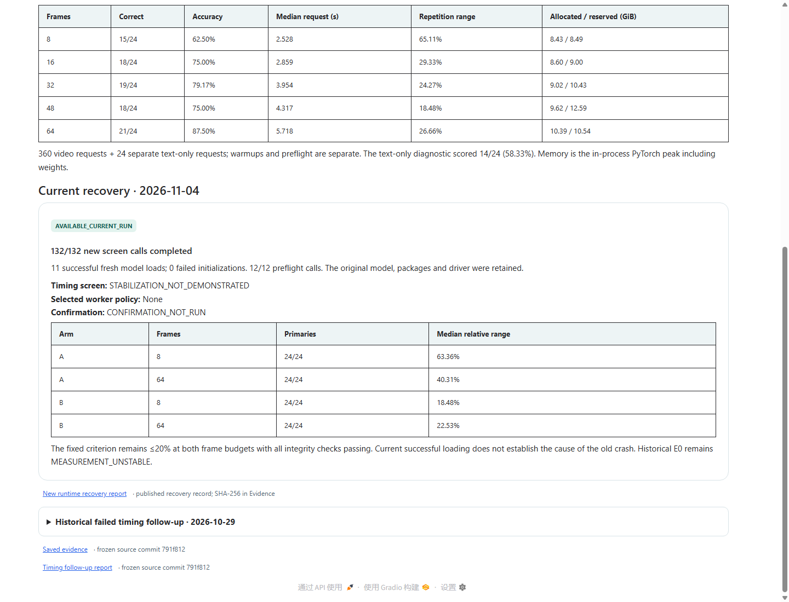

# E0 initialization and timing recovery

**Current E0 decision: resident policy B is GOOD under the user-amended ≤25%
acceptance rule.** Its 18.48% / 22.53% variation passes at both tested budgets.
The [new E0 report](../results/e000_20261104_acceptance25_v1/report.md) explicitly
records that the user changed the criterion after seeing the results. The
following history and original ≤20% decision are preserved.

The original timing follow-up stopped on 2026-10-29 while loading checkpoint
shards. Its worker exited with `0xC0000005`, and a contemporaneous Windows event
named `torch_cpu.dll`. No generation call had started, so its completed-call count
is correctly **0/132**. The 16 successful CPU preparations exercised video decoding,
the processor and tensor construction; they did not load the model weights.
That explains how the CPU checks could pass while model initialization failed.
The saved event alone does not establish the underlying cause.

The 2026-11-04 follow-up uses the same local Qwen3-VL-4B checkpoint, processor,
tokenizer, BF16/SDPA, packages, input tensors, prompt, parser, greedy controls and
timing boundary. It includes no package, driver or OS change. The first bounded
attempt successfully loaded two fresh models in about seven seconds each and
completed all 12 preflight calls. An inherited preflight verifier then rejected
the cumulative resource total using the superseded 27,600-second cap. No primary
timing observation was collected in that attempt. Its calls, failure, fingerprints
and resource charges remain preserved in the
[v6 checkpoint](../results/e000_20261104_044416_runtime_recovery_v6/checkpoint.json).

The [v7 protocol](../protocols/e000_runtime_recovery_v7.md) corrects that verifier
routing under a new implementation fingerprint and the existing 172,800-second
grant. It inherits all charges and invocations, validates reuse of the 16 sealed
CPU preparations, and runs fresh GPU calls. Its new observations are recorded in
the [recovery report](../results/e000_20261104_045654_runtime_recovery_v7/report.md)
and [runtime resolution](../results/e000_20261104_045654_runtime_recovery_v7/runtime_resolution.json).

The new screen completed **132/132 calls**, including all 96 primary timing
requests, with **11 successful model loads** and no initialization failure.
Independent verification passed, including all 132 native token sequences and
3,556 preserved historical files. The historical crash did not reproduce; its
underlying cause remains unproven. No package, driver or model change was needed
for the successful current execution.

| Worker policy | 8-frame median relative range | 64-frame median relative range |
|---|---:|---:|
| Fresh per budget/repetition (A) | 63.36% | 40.31% |
| Resident across budgets per repetition (B) | 18.48% | 22.53% |

The fixed rule requires ≤20% at both budgets and every integrity check. Neither
policy qualified, so full confirmation was not run. These are completed negative
stabilization results, distinct from the original missing observations. They do
not validate latency savings or an efficiency claim.

The [browser validation receipt](vidfit-runtime-recovery-validation.json) records
the real UI controls, exports, CPU frame preview, narrow-screen check and screenshot
hashes separately from the scientific GPU evidence.

Initialization availability, fresh/resident timing qualification and conditional
confirmation are separate outcomes. Successful loading today cannot identify the
old native fault or fill the original run's missing observations. The VidFit E0
tab shows the new recovery separately and retains the old failure in its historical
details. Historical E0 remains `MEASUREMENT_UNSTABLE`; E2B remains
`NOT_ADMITTED_E2A_ADVANCEMENT`.
