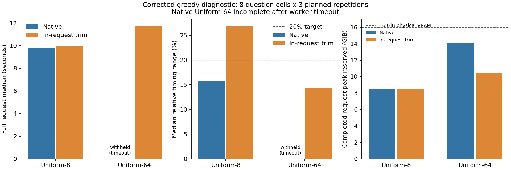

# Experiment 0 diagnostic correction

Answer disagreements have a confirmed implementation cause and a tested fix.
Native Uniform-64 reached the worker deadline; its complete timing gate cannot be confirmed. The trim arm misses that target and is not accepted as a general timing fix. This is a diagnostic subset, not a replacement full quality curve.

## Immutable lineage and scope

`e000_20261027_collection_v2` remains byte-for-byte unchanged: 461
files rehashed against the pre-investigation inventory. All original raw trials,
failures, configuration, figures and reports remain available. Original source is
preserved at Git commit `2e2b307`; this run freezes production fix `ffaf01d` and exact
source hashes in `plan.json`. The earlier forensic run and stopped allocator
intervention are preserved in `../e000_20261027_diagnostic_v1/`.

The matched comparison is `e000_20261028_diagnostic_v2`: first official question
per each of eight parent videos; frame budgets 8 and 64; three repetitions; paired,
alternating policies; fresh worker per policy/budget/repetition. No labels or
correctness entered selection or inference. 92/96 primary requests completed, with 1 timed-out attempt
and 3 unattempted identities. All 24 warmups and four separate
profiles completed. The exact prepared tensors of completed requests match the parent.

## Why the eight answers disagreed

In pinned Transformers 4.57.1, `_prepare_generation_config` can replace supplied
fields equal to global defaults with checkpoint defaults when `use_model_defaults`
is omitted. The declared `do_sample=False` was therefore replaced by the Qwen
checkpoint's `do_sample=True` (temperature 0.7, top-k 20, top-p 0.8). The [pinned generation implementation](https://github.com/huggingface/transformers/blob/v4.57.1/src/transformers/generation/utils.py) implements this precedence. The CPU audit in
`../e000_20261027_diagnostic_v1/generation_defaults_audit.json` reproduces the effective
sampling mode directly using the installed generation implementation. Random-number
state advanced with request order despite the fixed worker seed.

Forensics tested all eight flagged cells plus three prespecified stable controls.
Each arm had 66 target observations and 33 predecessor requests. Native execution,
RoPE reset, and deterministic math kernels each reproduced all eight disagreements.
Within each arm and case, vision features, prefill positions and first-token score hashes
were identical, prefill KV length/cache position were zero, and scores contained no
NaNs. Captured outputs sometimes selected a strictly lower-scored token. These
observations support random sampling, rather than input drift or request-state
leakage, as the cause. Exact top-score ties are handled as ties in verification.

Explicit call-level `use_model_defaults=False`, `do_sample=False`, one beam, eight
new tokens and resolved BOS/EOS/padding removed every disagreement: 0/11 unstable
cells across 66 target observations, including all eight original flagged cells.
The production adapter now validates the effective greedy mode, rejects conflicting
frozen policies and records effective settings in new model/worker manifests.
The paired production test has 92/92 parseable completed primary outputs,
zero answer disagreement cells and identical
generated token sequences across the observed calls for all 16 selected input cells.
Missing native-64 repetition-3 outputs are not fabricated or replaced.

**Interpretation correction:** the original collection's quality and timing curves
are historical sampled-generation outputs. They cannot establish the intended
frozen-greedy protocol. Their measured values have not been altered. A complete
five-budget corrected-greedy collection has not been performed here.

## Timing investigation

The first allocator intervention (`max_split_size_mb:128` with garbage-collection
threshold 0.75) regressed: a completed warmup took 144.346 seconds and reserved
19.106 GiB against 16 GiB physical VRAM. Its retry was stopped after more than 160
seconds to protect the remaining allowance. No primary timing requests were saved
in that phase. One completed warmup and two interrupted/unknown attempts remain.
One interruption was a system shutdown; its entire coordinator session was charged
through the verified Windows Kernel-General shutdown timestamp. The original
unclosed ledger and private OS evidence were preserved. Powered-off time was not
charged as active execution, and no previous consumption was removed.

The native-64 repetition-3 worker reached its predeclared 600-second limit while
its fifth primary request was still outstanding. That request has no saved output
or completed latency; its attempt is censored. Three subsequent identities were
never attempted. Device-wide observation during the stall showed almost all 16 GiB
in use. The outstanding attempt was not retried. The prespecified final cleanup
counterpart was then run with the same frozen worker code, inputs and limit.
Native-64's complete latency/range summary is withheld. Its listed memory counters
come from completed requests only and do not capture the failed request's peak.
`native_timeout.json` and `memory_pressure_observation.json` preserve the evidence.

The smaller named follow-up compares the default native allocator with the same
allocator plus `torch.cuda.empty_cache()` after input transfer and before generation.
Cleanup is **inside** the original synchronized full-request timer. BF16, native
SDPA, model/software/data revisions, canvas, prompt and parser remain fixed.
There is no offload, quantization or reused decoded video/vision/KV work.
The [PyTorch 2.8 CUDA documentation](https://docs.pytorch.org/docs/2.8/notes/cuda.html#memory-management) distinguishes live allocation from allocator reservations and documents cache release behavior.

| Policy | Frames | Completed / planned | Median request (s) | Median relative range | Cells >50% | Completed peak allocated / reserved (GiB) | Sampled device peak (GiB) |
|---|---:|---:|---:|---:|---:|---:|---:|
| native | 8 | 24/24 | 9.844 | 15.8% | 0/8 | 8.408 / 8.445 | 10.578 |
| native | 64 | 20/24 | withheld | withheld | withheld | 10.317 / 14.146 | 15.879 |
| request_trim | 8 | 24/24 | 9.994 | 26.9% | 1/8 | 8.408 / 8.453 | 10.334 |
| request_trim | 64 | 24/24 | 11.764 | 14.4% | 0/8 | 10.317 / 10.477 | 12.418 |

The 64-frame trim arm completed all 24 requests with a 14.4% median timing range
and 10.477 GiB peak reserved memory. This is a candidate mitigation for the observed
high-frame memory-pressure failure. It is not a general policy: at eight frames,
trimming increased median timing range from 15.8% to 26.9%. No speedup estimate is
reported for the censored native-64 condition.



Relative range is `(max-min)/median` over three repetitions per question; the table
reports its median over eight cells. Request medians first summarize each question's
three observations. PyTorch reservations are allocator counters and can exceed
physical VRAM under Windows; they are not resident device usage. NVML values are
50 ms sampled device-wide peaks, not process-specific or exact continuous maxima.

| Policy | Frames | Median CPU preparation (s) | Median request minus CPU preparation (s) | Median trim host span (s) |
|---|---:|---:|---:|---:|
| native | 8 | 8.881 | 0.937 | 0.0000 |
| native | 64 | 9.551 | 2.761 | 0.0000 |
| request_trim | 8 | 9.006 | 0.910 | 0.0129 |
| request_trim | 64 | 8.783 | 2.716 | 0.0481 |

| Policy | Frames | Median CPU share | CPU relative range | Centered CPU / total correlation |
|---|---:|---:|---:|---:|
| native | 8 | 90.4% | 14.2% | 0.981 |
| native | 64 | 78.7% | withheld | 0.966 |
| request_trim | 8 | 90.4% | 28.7% | 0.999 |
| request_trim | 64 | 76.1% | 17.1% | 0.992 |

The centered correlation subtracts each question cell's median before comparing its
within-condition completed observations (24 in a complete condition); critical timeout information is retained separately. The correlation is descriptive and has no significance test.
CPU preparation includes full sequential decoding, selection/resize and processor
work. Its observed share and covariation localize preparation stalls without
claiming a specific CPU clock, I/O or scheduling cause.

The request-minus-CPU remainder includes transfers, driver/allocator work, model
execution and output handling; it is not pure GPU time. Separate intrusive profiles
remain private. Memory pressure is a supported candidate for timing tails, especially
in the rejected allocator arm. These counters do not prove Windows paging as a
unique cause. Thermal/clock telemetry is retained; this small paired test does not
isolate every power, OS-cache or background-load effect. A different day and reduced
question set also prevent treating these numbers as a controlled before/after
comparison with the original full collection. No statistical significance claim.

## Verification and accounting

The final CPU regression suite passed 54 tests; Ruff passed on all source, test and
script files. The PNG was visually reviewed and the SVG parsed successfully.

Verification here tests record integrity and the targeted diagnostic, not full
five-budget feasibility or the 20% timing gate. It redecoded 517 saved outputs using
the pinned tokenizer, rehashed 12 model files, checked the
parent inventory, trial identities/order/completeness, input hashes, no OOMs in completed requests,
allocator backend, frozen effective policies, repeated answers/tokens and saved
memory/timer invariants. Raw evidence is private and bound by the published aggregate
hash in `verification.json`; annotation text, labels, weights and videos stay out of Git.

New work: 518 confirmed model invocations, including the completed inference whose
initial nonfinite-score JSON logging failed, plus 3 possibly invoked interrupted
attempts conservatively retained. Historical model calls: 491. Cumulative upper bound:
1,012 calls. Setup/recording/file-lock failures and their runtime remain accounted.

Cumulative active consumption at publication preparation: 11605.416
seconds of 14,400 (3.224 hours); remaining
2794.584 seconds. Project storage observed
15.8602 GiB, peak
15.8602 GiB of 20 GiB. Video acquisition remains
77.871 MiB plus a 1 MiB interrupted-transfer reserve,
below 1 GiB. No additional download, paid inference or cloud compute was used.
These totals include conservative external/overhead allowances and all failed attempts.
The authoritative continuing ledger is this run's `resource_ledger.json`.

Reproduction/validation commands (run only with matching local data and remaining budget):

```powershell
.venv\Scripts\python.exe -m pytest -q
.venv\Scripts\python.exe scripts/verify_e000_diagnostic.py
.venv\Scripts\python.exe scripts/report_e000_diagnostic.py
```

Do not resume the stopped 19 GiB allocator arm or reset a resource ledger. Any future
configuration/source changes require another named run. The targeted diagnosis is
complete; full five-budget greedy feasibility confirmation remains unclaimed.
