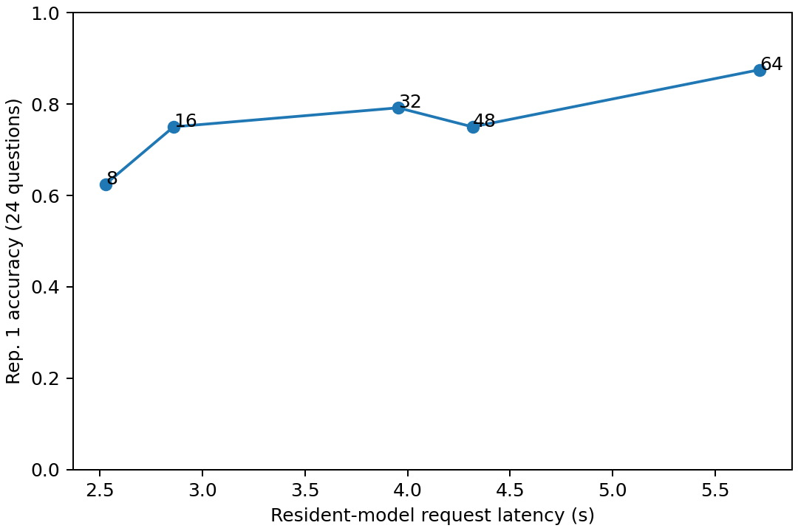
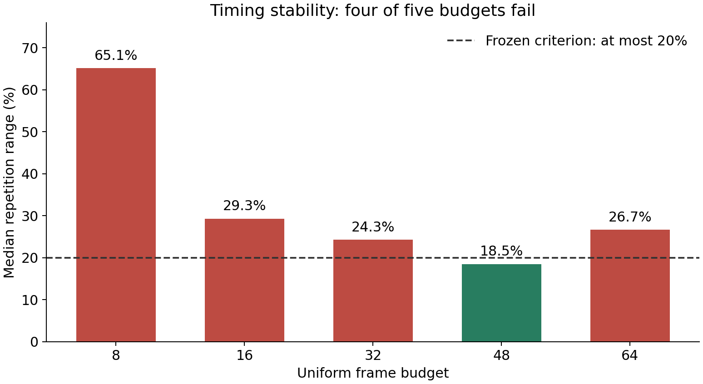
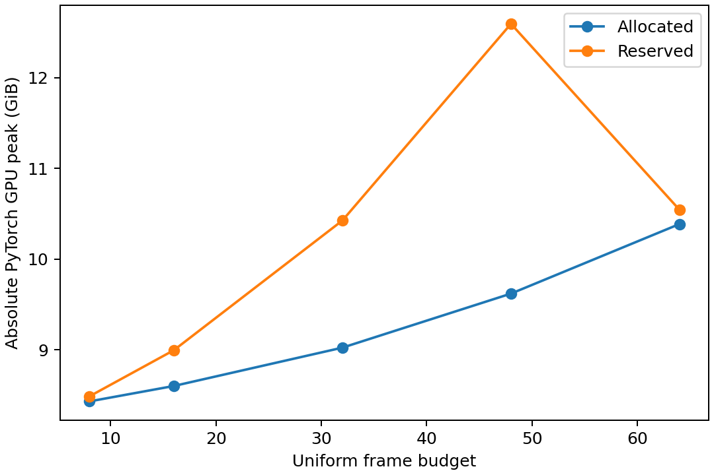
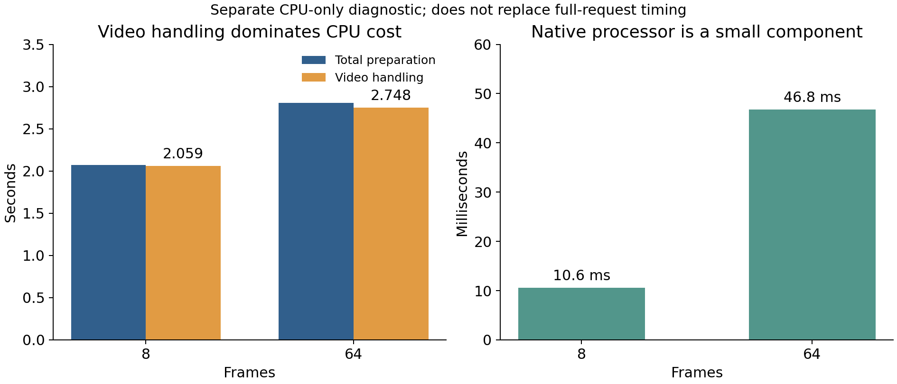

# Experiment 0 — corrected frozen Video-QA collection v3

Final experimental verdict: **MEASUREMENT_UNSTABLE**. All 360 video requests and 24 separate
text-only requests completed. Success requires every frozen operational gate,
including the 20% median relative timing-range criterion; completeness alone is
not feasibility confirmation. `independent_final_verification.json` separately
records saved-data integrity, which can pass even when an experimental gate fails.
The full collection completed, but feasibility is not confirmed. Budgets failing the timing criterion: [8, 16, 32, 64]. Consult the gate table for all other outcomes.

## Accuracy, timing, reproducibility and measured speedup

| Frames | Repetition-1 accuracy | Invalid answers | Median E2E seconds | Median repetition range | Reproducibility | Nominal 64/B frame ratio | Measured E2E speedup vs 64 |
|---|---|---:|---:|---:|---|---:|---:|
| Text only | 14/24 (58.33%) | 1/24 | 0.293 | n/a | separate single pass | n/a | n/a |
| 8 | 15/24 (62.50%) | 0/24 | 2.528 | 65.11% | 24/24 exact token cells | 8.000x | 2.262x |
| 16 | 18/24 (75.00%) | 0/24 | 2.859 | 29.33% | 24/24 exact token cells | 4.000x | 2.000x |
| 32 | 19/24 (79.17%) | 0/24 | 3.954 | 24.27% | 24/24 exact token cells | 2.000x | 1.446x |
| 48 | 18/24 (75.00%) | 0/24 | 4.317 | 18.48% | 24/24 exact token cells | 1.333x | 1.325x |
| 64 | 21/24 (87.50%) | 0/24 | 5.718 | 26.66% | 24/24 exact token cells | 1.000x | 1.000x |

Accuracy uses the fixed first repetition and all 24 questions. Timing takes the
median of three repetitions per question, then the median over the 24 questions.
Range is `(maximum - minimum) / median` for each question's three repetitions,
then the median over those 24 ranges. Text-only has one separate pass. Per-question
medians and ranges are saved locally in `private/question_repetition_medians.csv`;
they are not independent additional examples. No favorable repetition was selected.
Frame ratios are arithmetic counts, not measured speedups. Uniform accuracy need
not increase monotonically with frames.

| Frames | Median CPU preparation seconds | Median transfer/model/output remainder seconds | Peak allocated GiB | Peak reserved GiB | Sampled device peak GiB |
|---|---:|---:|---:|---:|---:|
| Text only | 0.001 | 0.292 | 8.314 | 8.336 | 9.633 |
| 8 | 2.041 | 0.534 | 8.432 | 8.488 | 9.947 |
| 16 | 2.160 | 0.714 | 8.602 | 8.996 | 10.372 |
| 32 | 2.629 | 1.174 | 9.024 | 10.426 | 11.744 |
| 48 | 2.667 | 1.604 | 9.620 | 12.594 | 13.934 |
| 64 | 3.191 | 2.365 | 10.387 | 10.543 | 11.931 |

CPU and remainder columns each apply the same per-question median procedure.
The remainder subtracts the nested host preparation span from synchronized full
request time; it includes transfer, allocator cleanup where configured, inference,
output transfer/decoding/parsing and synchronization. It is not pure GPU kernel
time. Separate medians need not add exactly to the reported median total. PyTorch
peaks include resident model weights and differ from total device usage. NVML
device peaks are sampled every 50 ms, not exact peaks or per-process allocations.
Unavailable WDDM per-process GPU values remain unavailable, not zero.
The 16 fresh collection workers had median resident allocated memory
8.266 GiB and median model-load time 7.412 seconds. Loading is
accounted separately and excluded from resident-model primary request latency.

Separate intrusive preflight profiles, on the prespecified first question only:

| Frames | CPU preparation seconds | Synchronized transfer seconds | Synchronized model/output seconds |
|---|---:|---:|---:|
| 8 | 3.008 | 0.0021 | 0.667 |
| 16 | 2.498 | 0.0038 | 0.782 |
| 32 | 2.171 | 0.0048 | 1.046 |
| 48 | 2.399 | 0.0064 | 1.550 |
| 64 | 2.397 | 0.0083 | 2.185 |

These profiles are diagnostic calls, not the 360 primary timings. The request timer
starts before opening the compressed local file and includes full decode, selection,
RGB conversion/bicubic letterbox, prompt/processor work, transfers, generation,
output parsing and final CUDA synchronization. Hashing/scoring/serialization and
model loading are outside primary latency and inside cumulative accounting.

Primary timing diagnostics across the three repetitions:

| Frames | Median CPU/request fraction | Median CPU repetition range | Median remainder repetition range | Within-question centered CPU/total correlation |
|---|---:|---:|---:|---:|
| 8 | 80.2% | 66.20% | 57.42% | 0.997 |
| 16 | 76.7% | 34.73% | 18.35% | 0.997 |
| 32 | 69.9% | 30.97% | 8.45% | 0.993 |
| 48 | 62.8% | 25.38% | 10.43% | 0.997 |
| 64 | 58.7% | 39.41% | 9.25% | 0.997 |

These are descriptive quantities. CPU time is part of total time by definition,
so their correlation is not independent evidence of a unique causal mechanism.
The remainder includes host scheduling, transfers, allocation, GPU work and output
processing. CPU, I/O, OS-cache, driver, thermal and scheduling effects are not
uniquely isolated by these measurements. No significance test is asserted.

## Gates and root causes

| Gate | Result |
|---|---|
| complete_collection | True |
| summary_reproduces | True |
| frozen_provenance_verified | True |
| records_valid | True |
| calls_reconciled | True |
| prepared_input_repeatability | True |
| parsed_answer_repeatability | True |
| timing_stability | False |
| no_live_memory_growth_flags | True |
| raw_token_repeatability | True |
| raw_output_repeatability | True |
| effective_greedy_generation | True |
| fit_and_input_integrity_probes | True |
| all_operational_gates_passed | False |
| real_inference_verified | True |

Transformers 4.57.1 checkpoint-default backfilling enabled sampling in the original
collection despite its requested `do_sample=False`. Explicit call-level
`use_model_defaults=False`, sampling disabled, one beam, eight maximum new tokens,
explicit token IDs and effective-mode validation correct that confirmed defect.
Every new request carries an effective-policy digest and a matching real worker
receipt. Repetitions execute in independent workers. No original stochastic
accuracy or latency measurements were reused as corrected-greedy measurements.

Four-thread full sequential PyAV decode preserves frozen source indices, timestamps,
uint8 pixels and processor tensors. Earlier CPU validation checked 16 raw pixel
pairs, 40 native input hashes and four direct tensor comparisons. The new independent
check matches all 384 primary input/metadata hashes to the original inputs and
redecodes all 384 generated-token outputs with the saved native tokenizer backend.
Historical decoding speedups of about 2.56x at eight frames and 2.12x at 64 frames
were CPU-only diagnostics; measured full-request speedups are in the table above.

Only 64-frame requests trim unused CUDA allocator cache after input transfer and
before generation, inside the original timer. Lower budgets retain native allocator
behavior because earlier trim-8 worsened variability. There is no frame, feature,
prefix or cross-request KV cache, offload, quantization or resolution reduction.
Reserved allocator memory is not live allocated memory and is not called a leak.
Live-growth flags and all sampled/absolute memory observations remain in raw records.

The initial 64-frame warmup stalled for more than seven minutes and was interrupted;
its completion remains unknown, with no fabricated output, latency or memory peak.
After the user authorized closing Hearthstone and NVIDIA Overlay, idle device memory
dropped from roughly 4.6 GiB to 0.65 GiB. Overlay automatically restarted with low
load. All five bounded probes then passed. This is evidence of a changed resource
environment, not proof that one specific app, fragmentation, Windows paging or
scheduling uniquely caused the stall. Failed attempts and the rejected resource
projection remain preserved. Primary collection has no replaced or synthetic trials.

## Resources and exact reproducibility

Original cumulative cap: four hours. Explicit grants raised it first to 5h20m and
then to **5h40m / 20,400 seconds**. The latter is a resource-only sidecar grant;
the already-frozen scientific configuration/source hashes were not rewritten.
`runtime_resource_grant.json` and the ledger identify the effective allowance.
The successful probes were revalidated, not rerun to obtain favorable measurements.
The 4,833.494-second remaining-work forecast retained a 1.5 factor, a 600-second
retry reserve and 180-second verification reserve. Collection began only after
the full forecast fit. One CUDA worker ran at a time; no new acquisitions, paid
services or cloud compute were used.

The collection ledger snapshot is `resource_ledger.json`. Current project-wide
accounting is `final_resource_accounting.json`, pointing to the later inherited
`../e000_20261028_cpu_stage_v4/resource_ledger.json` and including all follow-up work. Inherited time before v3 was 13,193.571727 seconds; every
subsequent setup, test, failure, worker, validation and reporting session is charged.
Closed idle gaps are excluded except explicitly conservative engineering allowances.
Storage includes the environment, weights, caches, temporary files, results and Git;
the unchanged limits are 20 GiB total additional storage and 1 GiB video acquisition.
The invocation upper bound is 1454, including
historical calls and all explicitly unknown interruptions; 441 new calls
completed, including 384 primary requests, 32 collection warmups and 25 preflight calls.

Model/processor/tokenizer: `Qwen/Qwen3-VL-4B-Instruct`, revision
`ebb281ec70b05090aa6165b016eac8ec08e71b17`, BF16, SDPA, unchanged 192x320 canvas.
Dataset annotation revision: `ead1408f75b618502df9a1d8e0950166bf0a2a0b`.
Base Git revision: `52773383da61f6751ce2f216298f454097b45efa`; intentionally uncommitted
code is identified by `source_provenance.json`, `resolved_config.yaml`, model/software
manifests and private exact-source snapshots. All 1,072 historical evidence files
remain byte-for-byte unchanged. The original cohort, 24 questions, five budgets,
three repetitions and execution order are unchanged.

Executed commands and reusable verification:

```powershell
.venv\Scripts\python.exe scripts/collect_e000_authorized_v3.py
.venv\Scripts\python.exe -m pytest -q --basetemp .cache/authorized-v3-tests
.venv\Scripts\ruff.exe check src tests scripts
.venv\Scripts\python.exe scripts/finalize_e000_v3.py
```

The coordinator automatically verifies the complete saved collection. The finalizer
performs independent aggregation, token decoding, original-input comparisons,
historical preservation and resource checks under the same ledger. CLI verification
with the original frozen input configuration retains its original planning cap;
use the authorized coordinator/finalizer for the effective runtime resource grant.

## Scientific limitations and next research step

This remains an eight-video, 24-question clustered development pilot. Repetitions
improve timing observation and test repeatability; they do not create independent
videos or establish statistical significance. Text-only accuracy is a diagnostic
for possible language priors/dataset shortcuts, not proof of the precise shortcut
mechanism. Uniform-64 samples 64 frames, not every frame, and is neither an oracle
nor an accuracy upper bound. Full decoding can dominate frame-count savings.
Observed budget differences do not identify causal benefits of computation, and
feasibility does not establish adaptive sampling or controller performance.

If every gate passes, preregister Experiment 1 on separate evaluation videos to test
whether inexpensive observations predict the marginal value of additional visual
computation, using these corrected uniform baselines as controls. If timing fails,
resolve the operational instability with a separately versioned diagnostic before
training or claiming an adaptive controller. Do not tune on this exposed cohort.

Suggested commit: `Complete frozen greedy Video-QA collection and independent validation`.
All changes remain unstaged. `final_changes.json` lists exact public-safe paths.
Keep `.venv/`, `.cache/`, videos, weights, credentials, annotations/questions/labels,
private manifests, raw trials, failed attempts and all private records/logs excluded.
The human user reviews, commits and pushes.


## Postcollection CPU diagnosis and final handoff

The separate [CPU stage diagnostic](../e000_20261028_cpu_stage_v4/report.md)
completed 48 preparations with exact collection-input hashes: eight original
sources, the first official question, 8/64 frames and three repetitions. No model
was instantiated and CUDA was never initialized. Median preparation was
2.072/2.806 seconds; the combined decode/selection/RGB/resize/stack span was
2.059/2.748 seconds (about 98–99% of preparation). Native processor calls were
0.0106/0.0468 seconds, copies/metadata/checks/other work 0.0028/0.0167 seconds,
and nested letterboxing 0.088/0.667 seconds. This localizes CPU cost to the video
pipeline, without separating every FFmpeg, I/O, timestamp-check or RGB operation.

CPU-only median repetition ranges were 11.17%/11.98% in one persistent process.
That differs from fresh GPU workers and cannot isolate a unique scheduling,
clock, I/O, cache or allocator cause. It does not replace any primary timing or
make the 20% full-request gate pass. All original failures remain preserved.

The evidence-backed next step is a controlled, separately versioned timing-policy
diagnostic (worker lifecycle, CPU/I/O scheduling or exact-equivalence decoding),
then real preflight before a new full collection. Hold adaptive-controller
research until the corrected baseline passes. The 80.6-minute guarded forecast
for another collection exceeds the remaining allowance in final_resource_accounting.json,
even before new policy development/preflight. No additional GPU collection was
launched. That forecast describes the observed policy, not a universal minimum
for an unknown faster implementation or a guarantee that another run would pass.

Final regression: **76 tests passed in 16.51 seconds**; Ruff and whitespace checks
passed. The new test rejects reopening an older allowance after a follow-up
ledger. Historical preservation checks cover all 1,072 files. The two figures
were visually inspected and agree with the saved summaries. Raw data, questions,
labels, outputs, videos, weights and private manifests/logs remain ignored.
All changes are unstaged; no Git index/history or remote repository was modified.
Exact changed paths and final source hashes are in final_changes.json.

Additional command: `.venv\Scripts\python.exe scripts/diagnose_e000_cpu_stages.py`.
Its preparation loop completed in 200.984 seconds under a 300-second bound.
The authoritative latest ledger is now in `../e000_20261028_cpu_stage_v4/`;
further work must inherit that closed cumulative ledger.


## Explanatory graphs and publication

The user explicitly authorized commit and push on 2026-10-28, superseding earlier
local-only instructions. Prior statements about an empty index describe their
verification timestamps. Model inputs, raw outputs, questions/labels, videos,
weights, and private records remain excluded. The public aggregate export is
`public_summary.json`; the local `summary.json` also contains per-question raw
repetition timings and is intentionally excluded from this publication.



Uniform-64 answered 21/24 correctly versus 15/24 at Uniform-8; 32 frames outperformed
48 frames on this small cohort. Connected points are descriptive uniform settings,
not an adaptive policy or proof of a causal computation benefit.



Only 48 frames met the frozen median range criterion. These bars explain the
MEASUREMENT_UNSTABLE verdict despite complete requests and exact output equality.



Absolute PyTorch peaks include the resident model. Reserved memory includes unused
allocator blocks; it is distinct from live allocation and total device usage.
Uniform-64 uses explicitly versioned in-timer cache trimming, while 48 frames does
not, explaining why their reservation policies differ. This is not evidence of a leak.



The video-handling span includes I/O, decoding, selection, RGB conversion, resize
and stacking. The native processor is shown separately in milliseconds. This
CPU-only diagnostic used a persistent process and cannot validate GPU-worker
timing stability or isolate a single OS/driver cause.

Recreate the two added plots with `.venv\Scripts\python.exe scripts/plot_e000_report.py`.
No model inference was run for publication. Next research should first stabilize
the timing baseline under a separately versioned protocol; adaptive-controller
claims require a later independent-data study.

Publication preserves exact executed CRLF bytes for the frozen Python modules and
input configuration via narrow .gitattributes rules. This prevents Git line-ending
normalization from invalidating the recorded SHA-256 fingerprints. The staged
source/configuration blobs are checked against those recorded hashes.
