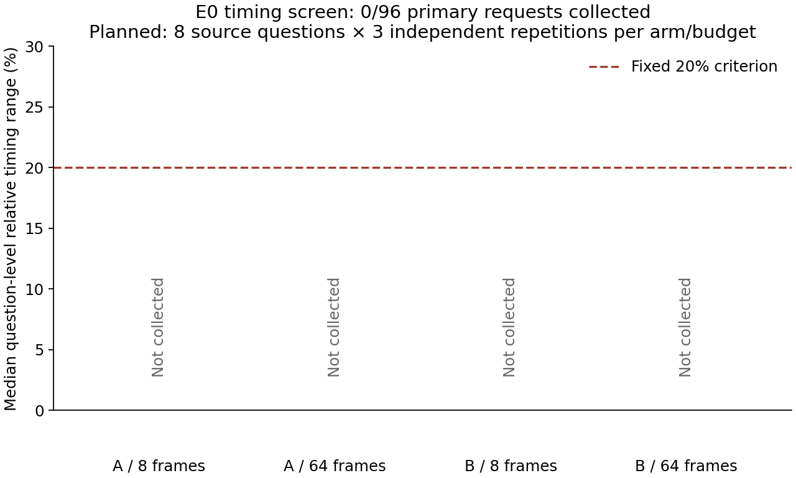

# E0 runtime recovery v6

Current runtime: **AVAILABLE_CURRENT_RUN**. Timing screen: **INCOMPLETE_OR_INTEGRITY_FAILED**.

The old 0xC0000005 initialization failure remains immutable evidence. This is a separately frozen attempt with the same native adapter, local checkpoint, software, inputs, generation controls and timing boundary. No package or driver was changed. Successful new loads do not establish the cause of the historical crash.

Completed 12/132 screen calls, including 12/12 preflight calls. Selected policy: None. Confirmation: CONFIRMATION_NOT_RUN.

| Arm | Frames | Primaries | Median relative repetition range |
|---|---:|---:|---:|
| A | 8 | 0 | unavailable |
| A | 64 | 0 | unavailable |
| B | 8 | 0 | unavailable |
| B | 64 | 0 | unavailable |

Qualification requires ≤20% at both budgets and every integrity gate. A is selected before B; no replacement sessions or exclusions. Historical E0 remains **MEASUREMENT_UNSTABLE**. E2B remains **NOT_ADMITTED_E2A_ADVANCEMENT**.

Independent saved-record verification: False; historical files unchanged: 3484.

Cumulative resource charge: 45625.141 / 172800 seconds. Every historical charge, including presentation work, is inherited; no new video acquisition.

The two model loads and all 12 preflight calls succeeded. The remaining screen was not launched: an inherited preflight verifier still enforced the superseded 27,600-second resource cap. This is a verifier migration failure, not a native initialization failure. All calls, charges and the failed gate are preserved for the separately named v7 implementation.
