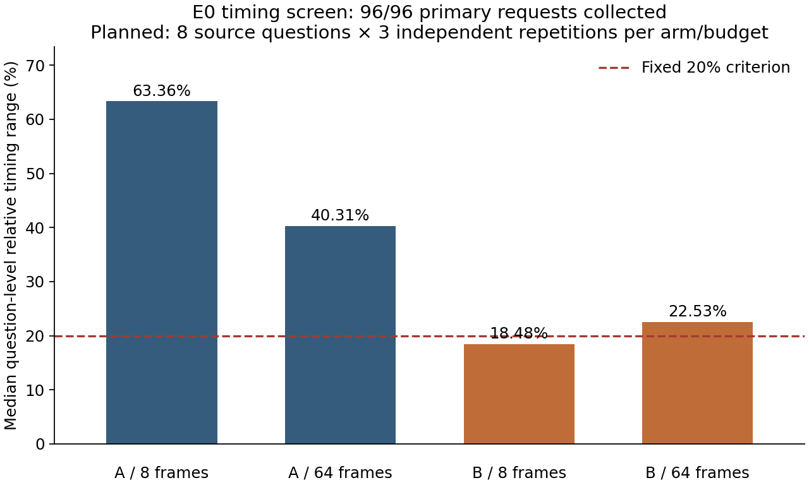

# E0 runtime recovery v7

Current runtime: **AVAILABLE_CURRENT_RUN**. Timing screen: **STABILIZATION_NOT_DEMONSTRATED**.

The old 0xC0000005 initialization failure remains immutable evidence. This is a separately frozen attempt with the same native adapter, local checkpoint, software, inputs, generation controls and timing boundary. No package or driver was changed. Successful new loads do not establish the cause of the historical crash.

Completed 132/132 screen calls, including 12/12 preflight calls. Selected policy: None. Confirmation: CONFIRMATION_NOT_RUN.

| Arm | Frames | Primaries | Median relative repetition range |
|---|---:|---:|---:|
| A | 8 | 24 | 63.36% |
| A | 64 | 24 | 40.31% |
| B | 8 | 24 | 18.48% |
| B | 64 | 24 | 22.53% |

Qualification requires ≤20% at both budgets and every integrity gate. A is selected before B; no replacement sessions or exclusions. Historical E0 remains **MEASUREMENT_UNSTABLE**. E2B remains **NOT_ADMITTED_E2A_ADVANCEMENT**.

Independent saved-record verification: True; historical files unchanged: 3556.

Cumulative resource charge: 49562.086 / 172800 seconds. Every historical charge, including presentation work, is inherited; no new video acquisition.

The preceding v6 attempt is preserved: two model loads and 12 preflight calls succeeded; an unmigrated historical resource verifier stopped that attempt before primary timing collection. This run fixes only that routing, inherits every charge and invocation, and retains all scientific rules.
