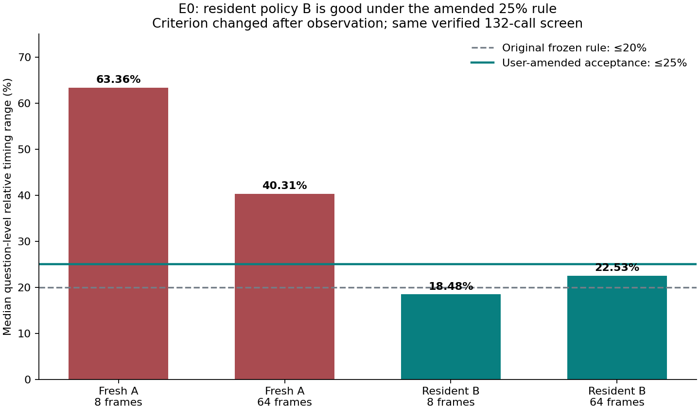

# E0: accepted under the amended 25% rule

**GOOD — resident policy B passes ≤25% at both tested frame budgets.**

The user explicitly changed the operational tolerance on 2026-11-04 after seeing the results. This is a retrospective acceptance amendment using the same verified measurements, not a new collection or an original 20% test passing.

| Policy | Frames | Median relative range | Original ≤20% | Amended ≤25% |
|---|---:|---:|---|---|
| A | 8 | 63.36% | FAIL | FAIL |
| A | 64 | 40.31% | FAIL | FAIL |
| B | 8 | 18.48% | PASS | PASS |
| B | 64 | 22.53% | FAIL | PASS |

Policy A fails at both budgets. Policy B passes both amended checks, so B is selected. The statistic is the median over eight source questions of (maximum−minimum)/median over three independent sessions. All 96 primary observations are retained.

The source screen completed 132 real calls and 11 successful model loads. This decision record adds **zero model calls**. Seals, fingerprints and timing aggregates were rechecked from the saved records.

The original `STABILIZATION_NOT_DEMONSTRATED` decision at 20%, the historical `MEASUREMENT_UNSTABLE` E0 verdict, and every raw trial remain unchanged. Full confirmation has not been run. This acceptance is operational; it establishes no latency-saving claim and does not change the E2A/E2B advancement result.

