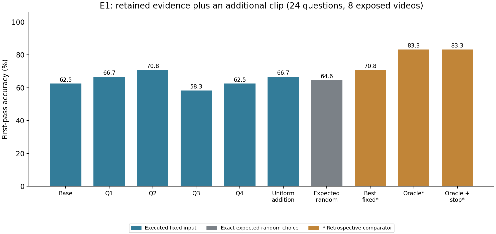
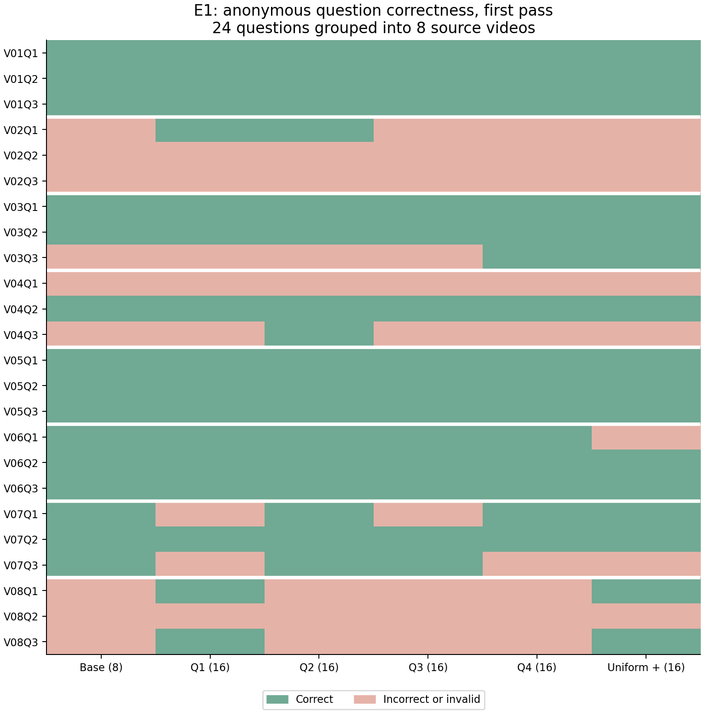
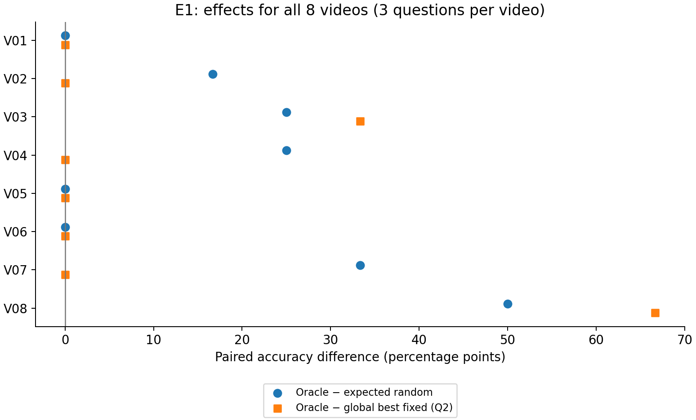

# Experiment 1 — additional-clip headroom

**Promising development headroom; larger independent evaluation is justified.**

This is an accuracy-only diagnostic on eight exposed Video-MME short videos and all
24 original questions from the official annotation test split. They are development
data. E0 remains **MEASUREMENT_UNSTABLE**. E1 does not validate latency savings.

## Design and completed evidence

We retain the exact Uniform-8 source frames, original timestamps and RGB pixels.
Four acquisitions add eight distinct frames from a fixed quarter; uniform addition
adds eight frames across the original timeline. All augmented conditions contain
16 frames and matched visual tokens at the unchanged 192 × 320 resolution.
Uniform addition shares the base target times, so its additions are the nearest
unused neighbors of base frames; comparisons apply to this specific nested control.
Timestamp formatting can change text-token counts at matched visual budgets;
[the per-video token table](augmented_text_token_differences.csv) records these differences.
This is full native-video re-encoding; temporal grouping and contextual representations can change.

The frozen Qwen3-VL-4B-Instruct model/processor/tokenizer revision is
`ebb281ec70b05090aa6165b016eac8ec08e71b17` (BF16, SDPA, visual-only).
The prompt/parser and explicit effective greedy policy are inherited from corrected E0.
See the [prospective protocol](../../protocols/e001_additional_clip_headroom_v1.md)
and [timestamped freeze](freeze.json). Labels are used only after inference.

Collection: **288/288** requests: two fresh-process passes
of all 24 questions × six conditions. Pass 1 is primary; pass 2 is a repeatability check.
Exact repeatability: **144/144** cells for inputs, tokens, raw outputs and answers.
Completed calls by kind: {'trial': 288, 'probe': 12, 'warmup': 8}. Failed calls: 0;
unknown interrupted calls (upper bound): 0.
Warmups and probes do not enter accuracy. Completed invalid answers score zero;
runtime failures would be missing measurements. All 24 questions remain in the denominator.

## Accuracy and headroom

| Condition/statistic | Correct / denominator | Accuracy |
|---|---:|---:|
| base | 15/24 | 62.50% |
| quarter1 | 16/24 | 66.67% |
| quarter2 | 17/24 | 70.83% |
| quarter3 | 14/24 | 58.33% |
| quarter4 | 15/24 | 62.50% |
| uniform_addition | 16/24 | 66.67% |
| random (retrospective/expected) | 62/96 action pairs | 64.58% |
| best_fixed (retrospective/expected) | 17/24 | 70.83% |
| oracle (retrospective/expected) | 20/24 | 83.33% |
| oracle_stop (retrospective/expected) | 20/24 | 83.33% |

| Paired contrast | Difference (pp) | Descriptive 95% cluster-bootstrap interval (pp) |
|---|---:|---:|
| oracle_minus_random | 18.75 | [7.29, 31.25] |
| oracle_minus_best_fixed | 12.50 | [0.00, 20.83] |
| oracle_minus_uniform | 16.67 | [4.17, 29.17] |
| oracle_minus_base | 20.83 | [4.17, 37.50] |

Descriptive request observations below use the 24 first-pass requests per
condition. All 288 individual timings/memory records are retained privately.
These times do not pass or repair E0’s timing-stability gate. Peaks include weights.

| Condition | Visual tokens | Input-token range | Median request (s) | Peak allocated / reserved (GiB) |
|---|---:|---:|---:|---:|
| base | 240 | 335–416 | 2.260 | 8.430 / 8.979 |
| quarter1 | 480 | 609–690 | 2.537 | 8.599 / 8.979 |
| quarter2 | 480 | 611–692 | 2.423 | 8.601 / 8.979 |
| quarter3 | 480 | 611–692 | 2.332 | 8.601 / 8.979 |
| quarter4 | 480 | 612–692 | 2.301 | 8.601 / 8.979 |
| uniform_addition | 480 | 610–692 | 2.484 | 8.601 / 8.979 |

The forced-acquisition oracle chooses one of four quarters, excluding uniform addition
and stopping. Random is the exact expected result over all four choices. Best fixed
is the strongest single quarter for this cohort, selected retrospectively. Oracle plus
stop may keep the base answer, so its gain is nonnegative by construction.

Base-wrong questions rescued by at least one quarter: 5.
Base-correct questions harmed by every quarter: 0.
Average action-induced harm: 4/96 question/action pairs
(4.17%). Mixed successful/unsuccessful choices:
7 questions across 5 videos.
Invalid answers by condition: {'base': 0, 'quarter1': 0, 'quarter2': 0, 'quarter3': 0, 'quarter4': 0, 'uniform_addition': 0}.

The frozen exploratory advancement rule **passed**.
It requires both oracle-minus-random and oracle-minus-best-fixed ≥10 pp, oracle
strictly above base and uniform addition, mixed choices in ≥3 videos, and every
integrity/collection/greedy/repeatability/independent-verification check. These are
engineering thresholds, not established statistical standards.

Bootstrap intervals use 10,000 resamples of complete source-video clusters, seed
20261029; all questions/actions stay together, and best fixed is recomputed in
each resample. Eight clusters provide weak uncertainty estimates. Repetitions
and clip actions are not additional independent examples. No significance claim.

## Figures and saved sources



Figure 1. First-pass accuracy on 24 questions from eight development videos. Orange
bars are retrospective comparators; enumeration requires real additional model calls.
Source: [metrics.csv](metrics.csv), [summary.json](summary.json).



Figure 2. All 24 first-pass questions, grouped into eight source videos, against six
executed conditions. Anonymous IDs contain no questions, labels or model answers.
Source: [correctness.csv](correctness.csv).



Figure 3. Paired effects for every source (three questions each). Best fixed uses the
same globally selected quarter across videos; within-video best-fixed contrasts are
also exported and explicitly distinguished. Sources: [per_video_effects.csv](per_video_effects.csv)
and the per-video rows in [summary.json](summary.json).

Recreate every figure and this report:

```powershell
.venv\Scripts\python.exe scripts/report_e001.py --run-dir results/e001_20261029_132707_v1
```

## Sensitivity, verification and limitations

| Omitted source | Oracle − random (pp) | Oracle − reselected best fixed (pp) |
|---|---:|---:|
| V01 | 21.43 | 14.29 |
| V02 | 19.05 | 14.29 |
| V03 | 17.86 | 9.52 |
| V04 | 17.86 | 14.29 |
| V05 | 21.43 | 14.29 |
| V06 | 21.43 | 14.29 |
| V07 | 16.67 | 9.52 |
| V08 | 14.29 | 4.76 |

The hindsight best fixed quarter within each video matches its oracle in 8/8 sources.
These label-selected local comparators are not validated policies. The positive
full-cohort result does not demonstrate question-specific selection beyond
source-specific preferred quarters. After leaving out one source and reselecting
best fixed, oracle-minus-best-fixed ranges from 4.76 to 14.29 pp;
it falls below 10 pp in 3/8 omissions. This sensitivity does
not change the frozen full-cohort advancement rule, but limits the finding.

E1 base predictions disagree with corrected E0 in 0/24 cells.
All 1719 historical E0 evidence files match their captured SHA-256 hashes.
Independent verification redecodes saved generated tokens with the frozen tokenizer,
reparses and scores all 288 records, checks real worker generation receipts, regenerates
all statistics/bootstrap intervals, and independently counts each primary endpoint.
See [verification.json](verification.json), [forecast.json](forecast.json),
[resource accounting](resource_accounting.json) and [source freeze](freeze.json).

Timings and absolute allocated/reserved peaks are saved in summary.json as descriptive
observations. No validated latency, FLOP saving, trained controller or practical ability
to select the right clip is established. The oracle is limited to this four-action menu.
No prompt/model/cohort search or training was performed. A negative result applies to
this configuration and exposed development menu; it does not disprove adaptive video
understanding generally. Do not start Experiment 2 automatically.

The project-wide cap is 27,600 seconds after the explicit +7,200-second resource-only
amendment. The ledger inherits every prior charge; storage remains 20 GiB including
environment/caches/Git and video acquisition remains capped at 1 GiB. No new downloads
or paid services. Restricted questions/options/labels/outputs/manifests remain local.

## Reproduce or resume

```powershell
$run = "results/e001_20261029_132707_v1"
.venv\Scripts\python.exe -m video_compute_value.e001 resume --config configs/e001.yaml --run-dir $run
.venv\Scripts\python.exe -m video_compute_value.e001 analyze --config configs/e001.yaml --run-dir $run
.venv\Scripts\python.exe -m video_compute_value.e001 verify --config configs/e001.yaml --run-dir $run
.venv\Scripts\python.exe -m video_compute_value.e001 close --config configs/e001.yaml --run-dir $run
```

Resume skips valid completed identities and never repeats completed answers.
Historical reproduction requires the original executed sources and matching scientific
fingerprints. A new collection requires a new run directory, inherited latest ledger,
the existing local restricted data/model cache, and sufficient explicitly authorized time.
