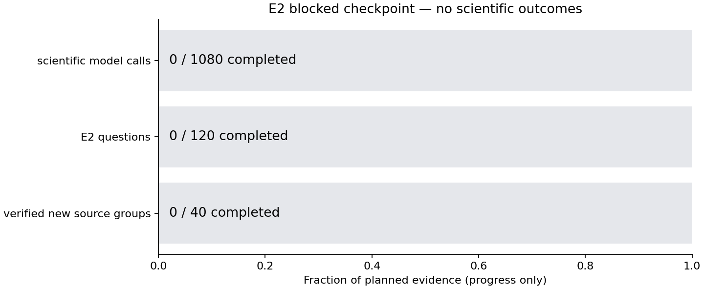

# Experiment 2 checkpoint

**E2 has no scientific result.** Implementation and a bounded compatibility attempt
were authorized; scientific collection was blocked. E0 remains MEASUREMENT_UNSTABLE.

| Status field | Current state |
|---|---|
| implementation | `PARTIAL_CPU_CORE` |
| collection | `BLOCKED_INPUT_AND_RESOURCE` |
| model_runtime | `PASSED` |
| predictive_value | `UNAVAILABLE_NO_E2_OUTCOMES` |
| explicit_question_contribution | `UNAVAILABLE_NO_E2_OUTCOMES` |
| timing_validity | `UNMEASURED` |
| practical_value | `PRACTICAL_VALUE_NOT_EVALUABLE_MEASUREMENT` |
| publication | `PENDING_GIT_VERIFICATION` |

| Evidence | Completed | Planned |
|---|---:|---:|
| Verified new source groups | 0 | 40 |
| Questions | 0 | 120 |
| Primary model calls | 0 | 960 |
| Repeatability calls | 0 | 120 |



This figure shows progress, not accuracy or latency. Exact source: [progress.csv](progress.csv).
Only the eight exposed legacy videos are local. They do not count as new E2 data.
The label-independent inventory found 292 ordered unexposed
short-source identifiers; identifiers alone do not certify source independence/CFR.
No download occurred. The bounded legacy compatibility status is `PASSED`;
completed compatibility calls: 5/5. Those calls never count
as E2 scientific evidence. See [compatibility receipt](compatibility.json).

Implemented CPU core: strict observation interface, V/Q/VQ deterministic features,
four-output ridge, grouped inner alpha fitting, separate held-out decision interface,
threshold feasibility, source bootstrap and timing summaries. E2-only runtime
primitives implement same-call C capture and direct/base-first request boundaries.
Full collection/OOF-artifact/cost-panel/B* orchestration is incomplete. CPU tests
cannot verify a real GPU path. No trained selector, calibration result, held-out
effect, question contribution, measured pipeline cost or efficiency claim exists.

The prospective [protocol](../../protocols/e002_preacquisition_predictability_v1.md)
retains 40 source groups, nested five-by-four source folds, signed gains,
training-only normalization and comparisons to fixed/random/uniform/oracle controls.
E2A advancement and E2B timing/cost gates remain distinct. This low-level/lexical
observation family does not represent every cheap observer. No E3 is authorized.

Current resources: 27390.965/27,600 seconds, including inherited
failures and closeout/publication reserve when charged. Latest exact values:
[resource_accounting.json](resource_accounting.json). The conditional unmeasured
E2A forecast needs 25479 additional seconds from this snapshot;
[the amendment request](resource_amendment_request.md) states every assumption.
Input/runtime gates and missing orchestration remain even with a resource grant.

```powershell
.venv\Scripts\python.exe -m video_compute_value.e002 resume --run-dir results/e002_20261029_073134_v1
.venv\Scripts\python.exe -m video_compute_value.e002 verify --run-dir results/e002_20261029_073134_v1
.venv\Scripts\python.exe scripts/audit_e002_publication.py --run-dir results/e002_20261029_073134_v1
```

These are implemented checkpoint commands, not a claimed full-collection command.
Historical preservation and real saved-record rescoring are in [verification.json](verification.json).
No synthetic test fixture enters the report. Missing metrics are blank/null, never zero.
