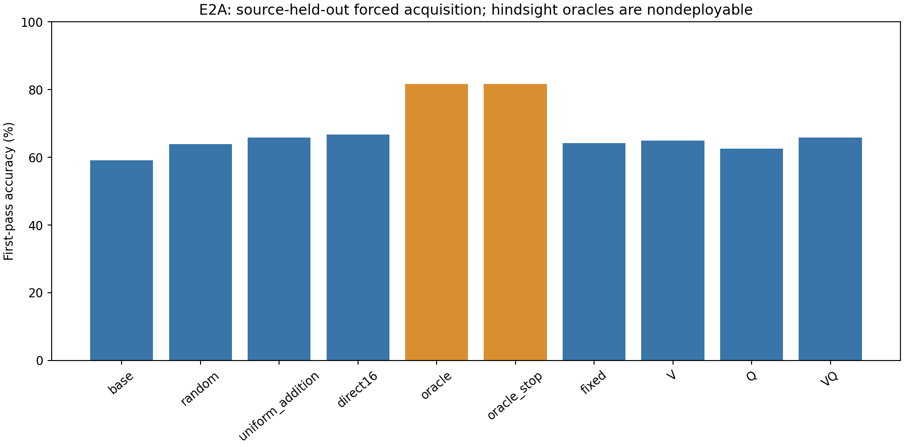
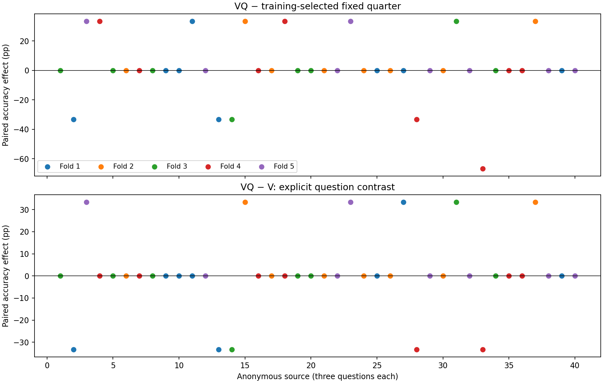
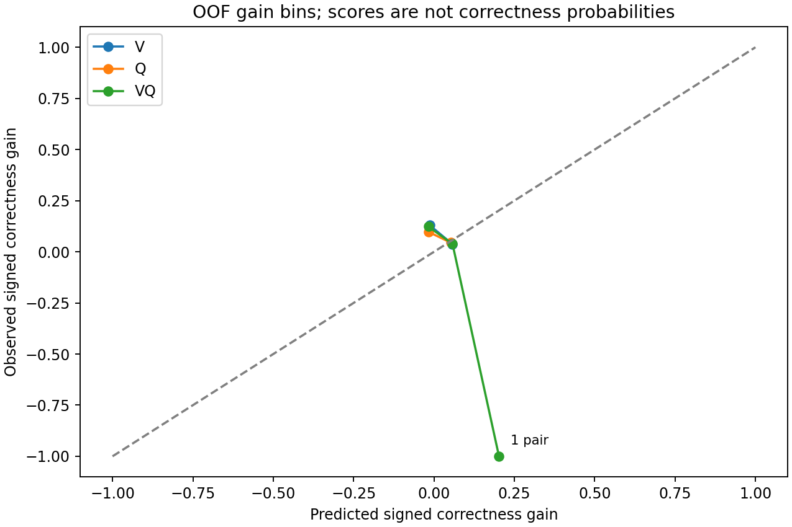
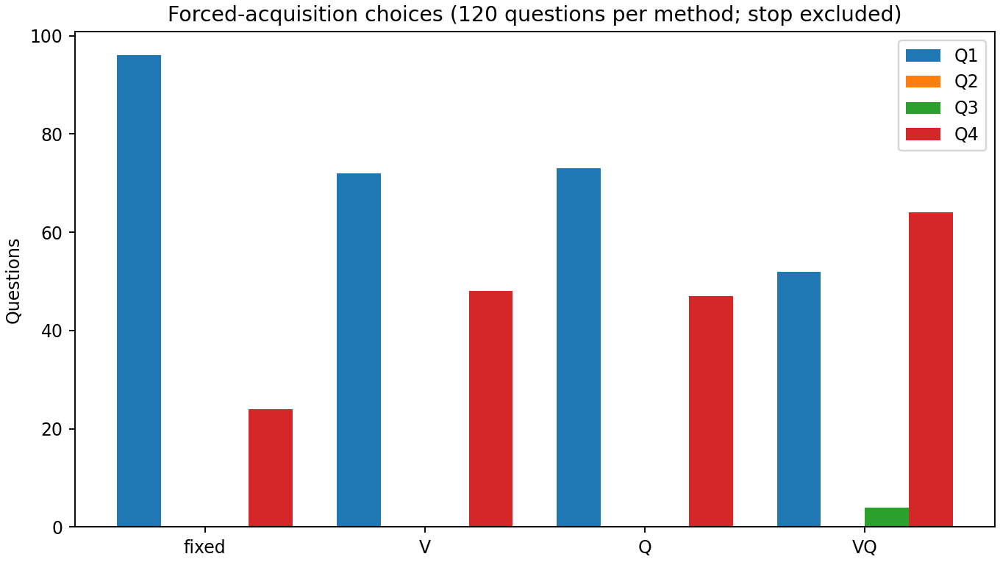

# E2A: pre-acquisition predictability

**Verdict: PREDICTIVE_VALUE_NOT_DEMONSTRATED_FOR_THIS_OBSERVATION_FAMILY.** Precision flag: INCONCLUSIVE_LOW_PRECISION.
Explicit question contribution: **NOT_DEMONSTRATED**.

E1 found opportunity by choosing an added quarter after seeing the answers. E2A
asks whether observations available before acquisition can predict signed
correctness change on held-out sources. V uses only the eight retained base RGB
frames and permitted geometry/timing metadata; Q hashes only original question
text; VQ adds the frozen deterministic interactions. Options, identities, paths,
labels, candidate outputs/costs and outside-base pixels cannot enter the policy.
The separate C diagnostic captures scores in the same paid base generation;
plain/observed token agreement passed for all 120 questions. VQ does not use C.

The development pilot collected 40 new official source groups and all 120 original
questions, with 960 primary and 120 fresh-process repeatability calls, plus
4 separate warmups. The earlier
five legacy compatibility calls are excluded. Five outer folds each held out eight
sources; four inner training folds selected regularization. V/Q/VQ use the unchanged
frozen cheap observation family and four independent ridge outputs. All held-out
predictions/actions were sealed before the evaluator joined outcomes.

Each quarter action retains the exact Uniform-8 base and adds eight distinct
frames, followed by a fresh complete 16-frame re-encoding. Nested uniform retains
the same base; Direct16 is sampled independently. Inputs use the shared frozen
Qwen3-VL-4B-Instruct model/processor/tokenizer revision
`ebb281ec70b05090aa6165b016eac8ec08e71b17`, BF16/SDPA, 192 x 320 canvases,
original timestamps and unchanged greedy prompt/parser settings. This is
recorded-video QA with a base spanning the timeline, not future-blind streaming.

| Method | Correct or exact expected correct | First-pass accuracy |
|---|---:|---:|
| base | 71.00/120 | 59.17% |
| random | 76.75/120 | 63.96% |
| uniform_addition | 79.00/120 | 65.83% |
| direct16 | 80.00/120 | 66.67% |
| oracle | 98.00/120 | 81.67% |
| oracle_stop | 98.00/120 | 81.67% |
| fixed | 77.00/120 | 64.17% |
| V | 78.00/120 | 65.00% |
| Q | 75.00/120 | 62.50% |
| VQ | 79.00/120 | 65.83% |

Delta_fixed = **1.67 pp**, descriptive conditional 95% source-bootstrap
interval **[-5.00, 8.33] pp**.
Delta_question = **0.83 pp**,
interval **[-4.17, 5.83] pp**.
Positive Delta_fixed folds: 2/5.
Advancement required >=5 pp, >=4 positive folds and a positive interval lower bound.

| VQ minus comparator | Effect (pp) | Descriptive conditional 95% interval (pp) |
|---|---:|---:|
| fixed | +1.67 | [-5.00, 8.33] |
| V | +0.83 | [-4.17, 5.83] |
| Q | +3.33 | [-2.50, 9.17] |
| random | +1.88 | [-3.54, 6.88] |
| uniform_addition | +0.00 | [-9.17, 9.17] |
| direct16 | -0.83 | [-10.00, 8.33] |



All 120 questions remain in every denominator. Expected random averages four actions;
orange hindsight oracles are nondeployable. Source: [metrics.csv](metrics.csv).



Every source contributes all three questions; color identifies its outer fold.
Source: [per_video_effects.csv](per_video_effects.csv); [fold_effects.csv](fold_effects.csv).



Signed-gain predictions are not answer correctness probabilities. Bin sizes range
from 1 to 449 action pairs; sparse bins are labeled on the figure.
Source: [gain_calibration.csv](gain_calibration.csv).



These E2A policies always acquire. Stop/acquire frequencies are unavailable unless
the separately gated practical stage runs. Source: [action_frequencies.csv](action_frequencies.csv).

VQ rescued 14 base-wrong questions and harmed
6 base-correct questions. Oracle regret:
15.83 pp. Action-gain MAE: V: 0.2021; Q: 0.2006; VQ: 0.2024.

Intervals use 10,000 paired source-cluster resamples, seed 2026102902. They condition
on the fitted OOF outputs and omit some split/training uncertainty; folds share
training sources. This is cross-fitted development from the official annotation
test split, not untouched confirmation or an official leaderboard result. Distinct
official source/parent IDs and asset hashes cannot exclude every unknown reupload.
A negative result concerns this observation family/model/action menu, not all cheap observers.
The [saved-record and model verification](verification.json),
[independent integer-contribution bootstrap](statistics_verification.json),
[decision seal](decision_seal_summary.json) and [feature schema](feature_schema.json)
support these estimates.

## E2B: practical compute value

E2B status: **NOT_ADMITTED_E2A_ADVANCEMENT**. Timing: **UNMEASURED**.
Practical value: **PRACTICAL_VALUE_NOT_EVALUABLE_MEASUREMENT**. E2A gains alone establish no
efficiency. E0 remains **MEASUREMENT_UNSTABLE**. See [practical_status.json](practical_status.json).

The E2A point estimate is below the 5 pp threshold, only 2 folds improve, and the primary interval includes zero. The frozen rule therefore stops E2B before its timing screen, training cost panels or live stop/acquire evaluation. E2B latency, overhead, memory and practical accuracy/cost contrasts are unavailable. The unexercised E2B GPU path is not validated by E2A collection or CPU tests.
There is no speedup claim. Any further observation family or confirmation study
would require a separately authorized, prospectively frozen experiment.

The resource-only grant was directly approved as 172,800 seconds total; all earlier
charges are retained. Current cumulative charge: **40437.945403/172800 seconds**.
This charge includes 600 seconds prepaid for final verification, Git publication and handoff; the charge is retained.
Storage at the accounting checkpoint: 17,469,961,688/21,474,836,480 bytes. Video traffic plus
interruption upper bound: 478,922,789/1,073,741,824 bytes.
Exact accounting: [resource_accounting.json](resource_accounting.json).
Actual versus protected stage forecasts: [stage_actual_vs_forecast.csv](stage_actual_vs_forecast.csv).
Protected forecasts include the 1.5 safety factor and explicit failure,
verification/reporting and closeout reserves. All completed stages fit them.

| Stage | Protected forecast (s) | Observed scope (s) | Observed minus protected (s) |
|---|---:|---:|---:|
| input_cohort | 9526.10 | 2601.05 | -6925.05 |
| cpu_preflight | 5100.00 | 918.77 | -4181.23 |
| E2A_collection | 22036.98 | 6918.99 | -15117.98 |

Input/CPU observations span their completed stages. Collection reports owned
worker wall time including loads and warmups; coordinator, analysis and report
work remains charged in the cumulative ledger.
These project resource spans are not validated deployed-policy latency measurements.
Historical protocol: [E2 v1](../../protocols/e002_preacquisition_predictability_v1.md);
implementation/resource history: [continuation v2](../../protocols/e002_continuation_v2.md).
All earlier run directories and historical scientific sources remain byte-for-byte preserved.
The original [blocked checkpoint](../e002_20261029_073134_v1/report.md) remains
immutable. The new [readiness report](readiness_initial.json) records this continuation separately.

```powershell
.venv\Scripts\python.exe scripts/resume_e002_continuation.py --run-dir results/e002_20261029_080758_continuation_v2
.venv\Scripts\python.exe -m video_compute_value.e002_continuation verify --run-dir results/e002_20261029_080758_continuation_v2
.venv\Scripts\python.exe scripts/report_e002_continuation.py --run-dir results/e002_20261029_080758_continuation_v2
```

Resume validates fingerprints and completed identities; it cannot retry native loading
failures, alter completed wrong/invalid answers, or evade a failed full-stage budget.
Restricted text, labels, raw generated answers, features, selector artifacts, traces,
videos and weights remain local. Publication is checked separately from scientific success.
